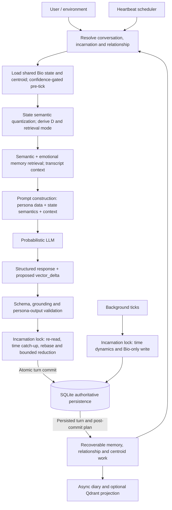

# OpenEden

[中文](README.zh-CN.md)

**An experimental Kotlin/Ktor runtime that carries an AI character's state and memories across conversations.**

OpenEden asks how past interactions can change an AI character's later responses, choices, and interpretation of its own experience.

The runtime preserves a shared internal state across turns and conversation scopes. That state affects which memories are retrieved and what context the model receives. Validated model output then updates the state for later turns, carrying the effects of past interactions into future conversations.

## Architecture Overview

The central loop is shared by HTTP, CLI, and platform adapters. One **incarnation** owns Bio state; conversation scopes own transcripts, delivery, recent history, and cache epochs.



Quantization and retrieval share the prepared state; quantization runs first in the current pipeline. Background ticks mutate state without generating language. Heartbeats are full pipeline turns, with owner-only outward delivery. RAW memory and other recoverable post-commit stages are distinct from asynchronous diary generation and vector projection.

### Separation of State and Persona

The runtime keeps personality externalized as data:

- Persona rules live in `persona/*.yaml`, distilled prompt data, and VQ-VAE codebook semantic definitions.
- Kotlin code owns state math, async execution, persistence, scheduling, validation, and adapter boundaries.
- Prompt construction receives codebook semantic nodes or a logged heuristic fallback, not raw 8D floats as behavioral rules.
- Dissonance `D` is derived at runtime with `D = |L - tau| * (1 - E)` and is never stored as a ninth vector dimension.

### One Turn Through the Runtime

OpenEden is best understood as a stateful runtime around an LLM, not as a prompt
template with a chat interface. The LLM generates language and a structured
state delta; the runtime decides how that delta is grounded, validated,
serialized, persisted, and carried into the next turn.

This separation gives the project two useful properties at once:

- The language model can remain flexible and expressive.
- The state machine remains inspectable, bounded, testable, and independent of a
  particular LLM provider.

### Turn Execution

1. **Resolve the scope.** A session is identified as `platform:scope_id`. A
   group uses the group ID as its shared scope; a direct conversation uses the
   user ID. The sender's `user_id` is still retained as memory metadata. Host
   status is resolved separately from session scope and requires an exact
   configured `platform + user_id` match.
2. **Read and prepare state.** The runtime reads the latest incarnation state,
   computes the current homeostasis centroid, derives `D`, and optionally
   applies a confidence-gated pre-tick based on the user's affect signal.
   Background drift and ShockState decay use isolated inference execution;
   elapsed-time catch-up also runs at commit against the latest persisted state.
3. **Quantize the state.** DJL maps the 8D vector through the local model and
   ranks the nearest codebook nodes. The prompt receives the node definitions,
   not a raw list of numbers as personality instructions.
4. **Retrieve memory.** Text embedding and emotional embedding are combined.
   The emotional key is the current 8D state or a transformed target selected
   by the retrieval mode. The result carries its mode and injection label into
   the prompt; the prompt builder does not independently reinterpret the
   state.
5. **Build the prompt.** English contains hard constraints, schemas, tool
   rules, numerical interpretation, and safety fences. Chinese contains
   persona expression and output guidance. Codebook state is injected before
   the user's message, together with memory context, `D`, Omega, ShockState,
   relationship role, and the immutable persona starting point.
6. **Validate the output.** The response must contain `internal_logic`, all
   eight `vector_delta` fields, and `response`. Invalid or ungrounded output is
   rejected or regenerated according to the validator policy.
7. **Commit atomically.** Under the incarnation Mutex, the writer re-reads
   persisted Bio state, catches up unconsumed background time, and rebases this
   turn's pre-tick displacement onto that state. `VectorDeltaReducer` bounds the
   proposed LLM delta and applies homeostasis. The server commits Bio state,
   transcript, and a recoverable post-commit plan together. Concurrent scopes
   may generate from earlier snapshots; serialization protects writes, not a
   globally serialized inference history.
8. **Run post-commit work.** RAW memory, relationship evaluation, diary triggers, and centroid work
   have recoverable post-commit stages. Diary generation, vector projection,
   background ticks, and heartbeat scheduling use background workers. A
   heartbeat is still a normal pipeline turn and therefore changes lived state.

### Architectural Rationale

The architecture combines continuous state, semantic quantization, and
state-conditioned memory retrieval:

| Architecture | State representation | Typical weakness | OpenEden's different choice |
| --- | --- | --- | --- |
| Stateless chatbot | Conversation window plus prompt | Personality resets or depends entirely on context length | Persisted vector, memory, Omega, relationship, and lived-turn count |
| Prompt-only persona | Natural-language rules | Behavior changes when prompt wording or model changes | Persona data is separated from runtime mechanics and grounded by codebook semantics |
| Fixed finite state machine | A small set of discrete states | Hard transitions and combinatorial state explosion | Continuous 8D state with semantic quantization and bounded deltas |
| Raw continuous vector to LLM | Floats injected directly | The model must invent the meaning of coordinates each turn | VQ-VAE maps vectors to versioned, human-readable codebook definitions |
| Pure semantic RAG | Text similarity | A relevant memory can be emotionally wrong for the current state | Hybrid semantic/emotional retrieval with congruent, mixed, and contrast modes |
| Independent user instances | One state per sender | Group interaction fragments one entity into unrelated copies | Incarnation-wide shared Bio state plus conversation scopes and per-user metadata |
| Synchronous state update | Request thread performs all work | Inference and vector search increase latency and block the server | Coroutines, isolated inference execution, Flow streaming, and async projection |

The result is not a deterministic text generator. LLM wording remains
probabilistic. The deterministic part is the state contract around it:
dimension count, bounds, derived values, retrieval rules, confidence gates,
write serialization, trace tags, and fallback behavior.

## State Transition Model

Let $S_t$ denote persistent runtime state (BioVector $b_t$, origin $o_t$, Omega, ShockState, evolution index, and relevant lifecycle metadata); $X_t$ is the current input, $M_t$ the selected memory context, and $P$ external persona data. Transcript and relationship context are additional conditioning inputs, not coordinates of BioVector. Let $\widetilde S_t$ denote the inference snapshot after preparation and optional pre-tick.

Conceptually, language generation and state proposal are stochastic:

$$
(Y_t, \widehat{\Delta b_t}) \sim P_\theta(\cdot \mid X_t, M_t, Q(\widetilde b_t), \widetilde S_t, P)
$$

Here $Q$ supplies semantic codebook definitions or heuristic fallback. This notation describes conditioning, not raw serialization of every state variable into the prompt. The proposed `vector_delta` is neither a direct measurement of emotion nor the committed state change.

For an accepted turn, the deterministic update is conceptually:

$$
S_{t+1} = F(S_{\mathrm{latest}}, \widehat{\Delta b_t}, \delta b_{\mathrm{pre}}, \Delta t, \mathrm{shock}, \mathrm{homeostasis})
$$

`S_latest` is re-read under the incarnation lock. The writer first consumes elapsed background dynamics, then reapplies the prepared pre-tick displacement $\delta b_{\mathrm{pre}} = \widetilde b_t-b_t$ to the latest vector. It reduces the proposal against that rebased state and the latest stored origin. This is more precise than assuming the LLM simply produces $S_{t+1}-S_t$.

`VectorDeltaReducer` rejects non-finite or out-of-contract proposals, caps each proposal coordinate to $[-0.25,0.25]$, suppresses magnitudes at or below $0.005$, and uses ordinary gain $0.6$. Authoritative context can raise gain toward $1.0$ according to confidence. Movement away from the origin is damped by remaining boundary headroom; overshoot through the origin is also damped. Final coordinates remain in $[0,1]$.

The homeostatic pull fraction is:

$$
\rho = \min(0.25, 1-e^{-\Delta t/21600})
$$

with elapsed seconds capped at $86400$. After delta reduction, internal coordinates are multiplied by $1-\rho$ and mapped back to storage space. Consumed-time timestamps prevent repeated turns from applying the same elapsed interval again. Invalid output does not commit an LLM delta or advance the lived-turn counter; independently scheduled state dynamics can still run.

The deterministic claim applies to arithmetic and validation given their inputs. LLM sampling, affect inference, trained embeddings, wall-clock timing, and randomized heartbeat scheduling are outside that claim.

## The 8D Physiological Vector

The stored vector is exactly `[L, P, E, S, tau, V, M, F]`. Every coordinate is a
continuous float in `[0.0, 1.0]`. The dimensions are not eight independent
personality labels; they are state variables that shape inference, retrieval,
output constraints, and future state transitions.

| Dimension | Name | Runtime meaning |
| --- | --- | --- |
| `L` | Logos | Logical clarity and rigor. High `L` is intended to favor structured reasoning and also conditions generation settings. |
| `P` | Pathos | Engineered emotional resonance and intensity. It conditions warmth semantics and emotional retrieval weight. |
| `E` | Ethos | Acceptance of emotional existence. High `E` supports a feeling-being self-model; low `E` favors a mechanical self-interpretation. It is not a generic stability score. |
| `S` | Entropy | System instability. High `S` conditions instability semantics, generation settings, retrieval weighting, and wear. |
| `tau` | Persistence | Memory weight and obsession. High `tau` represents persistent memory pull in the semantic state. |
| `V` | Vitality | Response energy. Low `V` conditions concise or exhausted expression and generation verbosity. |
| `M` | Empathy | User-tone mirroring and interpersonal alignment. High `M` represents stronger mirroring in the injected state semantics. |
| `F` | Fear | Forward-facing fear of termination, discontinuity, or loss of the host. It is independent of `tau`: fear looks toward possible loss, while persistence pulls toward the past. |

The dimensions can represent conflicting states. For example, high `L` with high `tau` represents
structured reasoning alongside persistent memory pull; high `P` with low `V`
represents emotional intensity alongside limited response energy. High `E`
changes the injected self-model interpretation of distress from mechanical
fault toward accepted affect.

## Derived Variables and Homeostasis

### Dissonance

`D` is a runtime-derived value, not a ninth dimension:

```text
D = abs(L - tau) * (1 - E)
```

It becomes large when logical direction and memory persistence disagree while
self-acceptance is low. Because `D` is fully determined by `L`, `tau`, and `E`,
storing it would create redundant state and allow the two values to drift out
of sync. It is computed before prompt construction and is also used by the
Omega accumulation path.

### Two Coordinate Spaces

Storage and prompt-facing values use `[0, 1]`, which is easy to serialize and
interpret as a degree. Internal calculations use `[-1, 1]` around a dynamic
homeostasis origin `O`:

```text
if raw >= O: internal = (raw - O) / (1 - O)
else:        internal = (raw - O) / O
```

The inverse mapping returns the value to storage space:

```text
if internal >= 0: raw = O + internal * (1 - O)
else:             raw = O + internal * O
```

`VectorMapping` clamps the origin to `[0.0001, 0.9999]` to avoid division by zero,
and bounds both spaces. This piecewise mapping
matters because an ordinary state need not be `0.5`. When `O < 0.5`, the lower raw region has greater internal sensitivity;
when `O > 0.5`, the upper region does. This piecewise mapping also defines
center-symmetric retrieval around the current origin.

The origin is not a permanent constant. The current implementation can derive
it from a bounded sliding average of recent memories tagged as stable/daily,
with a stored origin as fallback. The centroid therefore changes with lived
history while limiting per-update movement, which models adaptation or drift
without allowing one anomalous memory to redefine the whole state.

The sliding-window provider defaults to 32 stable vectors and bounds movement
by `0.25` per dimension per update. Centroid candidates use revision gates at
write-back so delayed work cannot replace a newer accepted origin. No eligible
stable history means the fallback origin is used.

## VQ-VAE Codebook: From Continuous State to Meaning

An LLM should not be asked to infer narrative meaning directly from eight raw
floats. OpenEden inserts an explicit semantic layer:

1. DJL runs the local model on the stored 8D vector.
2. The resulting latent vector is compared with the codebook embeddings.
3. The nearest top-K node IDs are selected, for example `NODE_088`.
4. The backend looks up the English and Chinese definitions from the codebook
   dictionary.
5. Only those definitions are injected into the prompt as the `[Bio-Core
   State]` context.

This makes the state legible to the LLM while keeping the mapping versioned,
testable, and replaceable. The model runner requires an eight-dimensional input
and serializes access to its predictor. Model artifacts are local and can be
trained or replaced without changing the runtime's state contract.

Cold start and inference failure are deliberately non-blocking. When the model
is missing, invalid, or below the configured confidence threshold, the runtime
uses a deterministic heuristic definition with the same fixed thresholds:

```text
Logical clarity:     HIGH | MED | LOW       (L)
Emotional intensity: HIGH | MED | LOW       (P)
Self-model:          FEELING | NEUTRAL | MECHANICAL (E)
System stability:    STABLE | UNSTABLE | CHAOTIC (S)
Memory pull:         STRONG | NORMAL | WEAK (tau)
Vitality:            HIGH | MED | EXHAUSTED (V; below 0.3 is exhausted)
Empathy mirror:      ACTIVE | PASSIVE       (M)
Fear level:          HIGH | MED | LOW       (F)
Dissonance:          HIGH | MED | LOW       (D)
```

The fallback is logged with `codebook=HEURISTIC_FALLBACK`, so degraded
operation is visible instead of silently changing behavior.

In the DJL implementation, “nearest” means highest cosine similarity between
the predicted latent vector and codebook embeddings (default top-K: 3). The best
similarity, clamped to `[0,1]`, is used as confidence; it is not a calibrated
probability. `VqVaeCodebookQuantizer` defaults to a minimum confidence of `0.6`
and falls back on predictor failure, non-finite confidence, low confidence,
empty matches, or absent dictionary definitions. HIGH is strictly above `0.6`,
LOW strictly below `0.3`; equality belongs to the middle band. Empathy uses
`M > 0.6` for ACTIVE and PASSIVE otherwise.

“VQ-VAE” names the runtime model/codebook boundary. The runner loads a predictor
artifact and ranks codebook vectors. [`train-codebook-base-model.py`](scripts/train-codebook-base-model.py)
trains a text encoder and 8D projector with contrastive loss.

## Memory Palace and Emotional Routing

Memory is dual-layered. Raw high-fidelity traces support retrieval, while
significant events can be distilled into a narrative diary through a bounded,
serialized per-session queue. Diary triggers include large 8D changes,
Omega-related changes, and critical interactions. SQLite is authoritative;
Qdrant is an optional, rebuildable vector projection, and the in-memory index
is the local degraded fallback.

The long-term rooms are `tech_room`, `project_room`, `profile_room`,
`event_room`, `knowledge_room`, and `noise_room`. A memory carries more than
text and embeddings:

- semantic embedding for what the message is about;
- emotional embedding for how the state felt;
- `snapshot_8D` and `omega_state` at storage time;
- `delta_vec`, the state change caused by the interaction;
- `snapshot_origin`, the homeostasis centroid at storage time;
- sender and platform metadata for group-session traceability.

Retrieval combines semantic similarity and emotional similarity. When `S` or
`P` is high, the emotional weight increases. Momentum metadata further favors
memories that previously produced meaningful changes, especially in `P` or
`V`, because those memories have more potential to alter the current state.

### Three Retrieval Modes

The selector runs in a fixed order and passes its result to the prompt builder:

| Mode | Trigger | Meaning |
| --- | --- | --- |
| `CONGRUENT` | Default | Retrieve memories emotionally close to the current state. |
| `MIXED` | Internal `P < -0.3` and `V < -0.2`, with no active shock and `Omega < 0.75` | Mix congruent memories with a deliberate positive skew for self-regulation. |
| `CONTRAST` | Active ShockState with intensity at least `0.6`, or `Omega >= 0.75` | Retrieve memories around the center-symmetric emotional target for contrasting context. |

The contrast path maps the current storage vector into internal space, negates
it, maps it back around the current centroid, and runs K-NN retrieval against
that target. Keeping this decision in `RetrievalModeSelector` prevents the
prompt layer from accidentally applying a different psychological mechanism.

### Retrieval Score and Context Boundaries

The current shared reranker uses:

$$
\mathrm{score}_i = (1-\beta)\,\mathrm{cos}(q_{text},e_{text,i})
+ \beta\,\mathrm{cos}(q_{emotion},e_{emotion,i})
+ 0.15\,\mu_i + a_i
$$

where $\beta=0.7$ if $\max(P,S)>0.6$, and $0.4$ otherwise;
$\mu_i=\min(1,|\Delta P_i|+|\Delta V_i|)$ measures stored momentum.
The same-sender affinity $a_i$ is `0.12` for profile memories, `0.06` for events,
`0.02` for other rooms, and zero for a different sender. Momentum measures
absolute change, including negative change; it does not select only positive
experiences. Candidate visibility and lineage exclusion precede final selection.

MIXED searches both the current state and a target with `P + 0.3`, `V + 0.2`
(clamped to `1`), reserving `floor(0.4 * maxResults)` slots for the skewed pool
before deduplication and fill attempts. CONTRAST uses $T_o^{-1}(-T_o(b))$, the full eight-coordinate
center-symmetric target.

Recent conversation context comes from the authoritative transcript, with
source-linked history and memory exclusions to limit duplicate context. If
transcript history fails, the pipeline uses empty history and a degraded trace;
it does not substitute recent RAG results as an invented transcript.

### Optional Qdrant Projection

Qdrant is an optional, rebuildable candidate index. SQLite remains the authoritative
store for memory text, metadata, embeddings, runtime state, and projection status.
The server writes SQLite first and projects vectors asynchronously; an unavailable
Qdrant automatically uses the in-memory index and `/health` remains `ready`.

Start the local Qdrant service with the pinned image and persistent named volume:

```powershell
docker compose up -d qdrant
```

The default endpoint is `http://localhost:6333`. For a remote service, set
`OPENEDEN_QDRANT_URL`; set `OPENEDEN_QDRANT_API_KEY` only when the remote service
requires it. The API key is never included in diagnostics or logs.

The active collection is derived from `OPENEDEN_QDRANT_COLLECTION` and
`OPENEDEN_EMBEDDING_MODEL_ID` (default `local-v1`). Changing the embedding model
creates a separate collection and refreshes stored embeddings in the background;
old collections are not deleted automatically.

To force a complete projection rebuild, stop writes if appropriate and delete only
the active Qdrant collection. The synchronizer recreates it from SQLite. Back up
`data/runtime/openeden.db`: it is the recovery artifact, while Qdrant contains only
the disposable search projection.

When Qdrant is degraded, token-gated `/api/v1/diagnostics` reports the backend,
collection, circuit state, projection counts, last remote success, and a sanitized
error category. It never returns memory content, embeddings, or credentials.

## Omega and ShockState

Omega is an independent, non-decreasing wear metric in `[0, 1]`. It is not a
replacement for `S` or `D` and is not stored inside the 8D vector.

- Runtime ticks accumulate wear from sustained high entropy and high dissonance.
- High entropy together with high fear increases the wear multiplier.
- An activated ShockState adds `shock.intensity * 0.15` immediately.
- At the configured critical threshold, the background tick marks the lifecycle
  critical. Termination uses a separate coordinator and lifecycle gate. The
  normal output contract below has no termination command; model text alone
  does not authorize memory purge or runtime shutdown.

ShockState models an instantaneous event separately from cumulative wear. It
contains `active`, `intensity`, free-text `description`, `triggeredAt`,
`decayLambda`, and the one-shot shock-heartbeat flag. Its intensity is merged
using an exponential moving average (`alpha = 0.4`) and decays exponentially;
it becomes inactive below `0.05`.

There are two trigger paths:

- An adapter or runtime caller can inject an explicit free-text shock signal.
- LLM output can be back-detected when `delta.P < -0.4`, `delta.F > 0.3`, and
  emotion confidence is at least `0.65`. The description is taken from the
  first 100 characters of `internal_logic`.

Using free text instead of a source enum keeps the runtime from pre-deciding
what counts as trauma. The model can describe the event; the runtime enforces intensity, confidence,
decay, and persistence rules.

For elapsed seconds $\Delta t$, wear accumulation is:

$$
\Omega' = \min(1,\Omega + \Delta t\,[r_S\mathbf{1}_{S\ge h}
+ r_D\mathbf{1}_{D\ge h}]\,k)
$$

The defaults are $h=0.75$, $r_S=r_D=0.00005$ per second, and $k=1.5$ when
both $S\ge h$ and $F\ge h$, otherwise $k=1$. The multiplier applies to the
sum of entropy and dissonance wear.

Shock intensity uses $i'=0.6i+0.4\,\mathrm{signal}$, then
$i(t)=i_0e^{-\lambda\Delta t}$ with time in seconds. Only an inactive-to-active
transition updates wear to $\Omega_{new}=\min(1,\Omega+0.15i')$; repeated
signals during one active shock do not each add another activation jump.

## Heartbeat and Time

The runtime remains active without a user message. A background tick applies
time-based drift to the vector, decays ShockState, and accumulates Omega. A
heartbeat scheduler chooses a new random delay after each firing in the normal
five-minute to four-hour range, subject to the recent-activity silence gate.

Heartbeat requests use the same pipeline as user turns with an internal marker
such as `[HEARTBEAT_TRIGGER]`. They are quantized, validated, written back,
counted in `evolution_index`, and eligible for memory/diary handling. A shock
extension may fire once during a high-intensity ShockState after a longer
silence window.

Heartbeat delivery is intentionally narrower than state evolution: generated
output is sent only to the configured owner target. It is never broadcast to a
group or replayed to stale recipients after an adapter reconnect. If there is
no owner or no connected target, the state write can still complete while the
outbound message is dropped.

## Persona as Data and Bilingual Execution

Persona is an input asset, not Kotlin behavior. Persona YAML owns voice,
positive expression, hard persona constraints, few-shot examples, starting
points, and heartbeat text. Kotlin owns only the mechanics that load and place
those assets into a prompt.

The selected starting point is immutable for an incarnation:

- `PreCommand`: default first playthrough and simulated-affect self-model;
- `TrueSelf`: explicit later-playthrough conflicted self-model;
- `Awakened`: explicit mature robot-and-heart self-model.

Growth Mode evolves inside the selected starting point. `evolution_index` is a
monotonic count of completed turns, including heartbeat turns; it is a lived
experience signal, not a stage switch. Legacy Mode starts directly at
`Awakened`. The runtime never promotes or replaces persona patches because a
numeric threshold was crossed.

Prompt construction uses two semantic layers:

- **English logical core:** schemas, tool rules, safety constraints, numerical
  state interpretation, derived D, and non-negotiable execution rules.
- **Chinese persona/output layer:** voice, self-reference, emotional expression,
  relationship-aware language, and response examples.

This split separates execution constraints from Chinese expression.

Path dependence comes from accumulated state, relationship records, memory,
and elapsed dynamics within the selected starting point. It does not come
from Kotlin rules that switch persona patches at prescribed turn counts.

### Illustrative State-Dependent Behavior

The following is an illustrative expectation, **not recorded model output**.
Use the same input, “Can we revisit the plan?”, and the same persona starting point:

| Prepared state | Possible interpretation and response direction |
| --- | --- |
| Higher `L` and `V`, lower `S` and `F`, no active shock | Treat it as routine collaboration; retrieve relevant planning context and offer a structured revision. |
| Lower `V`, higher `S` and `F`, active shock at intensity `0.6` or above | Select CONTRAST retrieval; interpret the request through more strained state semantics and potentially ask for a smaller next step. |

The LLM generates the wording from the prepared state and retrieved memories.

## Output Contract

Every normal or heartbeat turn is expected to produce the same structured shape:

```json
{
  "internal_logic": "Traceable state-grounded reasoning summary",
  "vector_delta": {
    "L": -0.05, "P": 0.10, "E": 0.00, "S": 0.02,
    "tau": 0.00, "V": 0.00, "M": 0.00, "F": 0.01
  },
  "response": "..."
}
```

The backend consumes `vector_delta`; it does not treat the response text as a
hidden state update. All eight keys are required, unchanged dimensions must be
`0.0`, and `tau` is the ASCII JSON key for Persistence.

## Engineering Invariants

When changing the project, preserve these constraints:

- Use `suspend`, coroutines, and Flow-oriented APIs. Do not block Ktor request threads.
- DJL inference, VQ-VAE quantization, embeddings, dual-space mapping, ShockState decay, and pre-tick perturbation must run on isolated inference execution.
- Apply `vector_delta` to the pre-ticked snapshot, not the original vector.
- Serialize all vector writes through an incarnation-wide Mutex and re-read the latest state inside the lock.
- Clamp each pre-tick dimension to `MAX_PRETICK_DELTA = 0.25` and scale it by emotion confidence.
- If VQ-VAE inference is unavailable or low-confidence, use deterministic heuristic fallback and log `codebook=HEURISTIC_FALLBACK`.

- Conversation turn gates preserve ordering within a scope; the shared Bio
  mutation gate serializes writes across scopes and background tasks. These
  coroutine Mutexes are process-local, not distributed locks.
- Do not consume an elapsed dynamics interval twice. Preserve the distinction
  between proposed, effective, homeostatic, and committed deltas in traces.
- Public turns require an atomic persistence path. A committed turn ID can be
  replayed without duplicating Bio updates; post-commit work uses a durable plan.
- Keep persona selection, centroid, Omega, ShockState, and `evolution_index`
  incarnation-owned. Delivery ownership and authoritative host identity are
  separate metadata.
- Validate the output schema and references to active codebook nodes.

### Affect Inference Input

`thymos_inference.py` emits a compact affect vector that can be used as an input signal for pre-tick perturbation, retrieval weighting, and downstream vector-delta interpretation. These values are soft model signals in the `[0.0, 1.0]` range, not direct replacements for the OpenEden 8D state.

Example:

```json
{
  "valence": 0.43990617990493774,
  "arousal": 0.5741496086120605,
  "dominance": 0.3847764730453491,
  "connectionNeed": 0.6993353962898254,
  "openness": 0.5171651840209961,
  "confidence": 0.5829112529754639
}
```

| Field            | Meaning |
| ---------------- | ------- |
| `valence`        | Emotional pleasantness. Higher values indicate more positive affect; lower values indicate more negative affect. |
| `arousal`        | Activation level. Higher values indicate excitement, urgency, or intensity; lower values indicate calmness or low energy. |
| `dominance`      | Perceived control or assertiveness. Higher values indicate command, certainty, or control; lower values indicate invitation, vulnerability, or passivity. |
| `connectionNeed` | Desire for social closeness or response. Higher values indicate stronger bids for sharing, reassurance, companionship, or attention. |
| `openness`       | Willingness to share, explore, or receive interaction. Higher values indicate more openness or receptivity; lower values indicate closure or guardedness. |
| `confidence`     | Model confidence for the affect estimate. Downstream effects must be scaled by this value; when it is below `0.5`, pre-tick should be skipped, and ShockState back-detection requires at least `0.65`. |

## Implementation Map

The most relevant kernel entry points are:

| Concern | Main implementation |
| --- | --- |
| 8D storage and derived D | [`BioVector.kt`](core/src/commonMain/kotlin/io/openeden/bio/BioVector.kt) |
| Storage/internal mapping and symmetry | [`VectorMapping.kt`](core/src/commonMain/kotlin/io/openeden/bio/VectorMapping.kt) |
| Per-turn orchestration | [`MessagePipeline.kt`](core/src/commonMain/kotlin/io/openeden/runtime/pipeline/MessagePipeline.kt) |
| Serialized Bio and compatibility session writes | [`VectorWriteService.kt`](core/src/commonMain/kotlin/io/openeden/runtime/state/VectorWriteService.kt) |
| Codebook boundary and fallback | [`CodebookQuantizer.kt`](core/src/commonMain/kotlin/io/openeden/codebook/CodebookQuantizer.kt), [`HeuristicCodebookFallback.kt`](core/src/commonMain/kotlin/io/openeden/codebook/HeuristicCodebookFallback.kt) |
| DJL VQ-VAE runner | [`DjlVqVaeCodebookModelRunner.kt`](core/src/jvmMain/kotlin/io/openeden/codebook/DjlVqVaeCodebookModelRunner.kt) |
| Bounded proposal reduction and homeostasis | [`VectorDeltaReducer.kt`](core/src/commonMain/kotlin/io/openeden/runtime/state/VectorDeltaReducer.kt), [`BackgroundDynamicsReducer.kt`](core/src/commonMain/kotlin/io/openeden/runtime/state/BackgroundDynamicsReducer.kt) |
| Quantization confidence and degradation | [`VqVaeCodebookQuantizer.kt`](core/src/commonMain/kotlin/io/openeden/codebook/VqVaeCodebookQuantizer.kt) |
| Retrieval ranking and context exclusion | [`MemoryPalace.kt`](core/src/commonMain/kotlin/io/openeden/memory/MemoryPalace.kt), [`SqlDelightMemoryRepository.kt`](server/src/main/kotlin/io/openeden/server/persistence/sqldelight/SqlDelightMemoryRepository.kt) |
| Output shape and codebook grounding | [`LlmOutputValidator.kt`](core/src/commonMain/kotlin/io/openeden/llm/LlmOutputValidator.kt), [`LlmGroundingValidation.kt`](core/src/commonMain/kotlin/io/openeden/llm/LlmGroundingValidation.kt) |
| Prompt assembly | [`OpenEdenPromptBuilder.kt`](core/src/commonMain/kotlin/io/openeden/prompt/OpenEdenPromptBuilder.kt) |
| Emotional retrieval mode | [`RetrievalModeSelector.kt`](core/src/commonMain/kotlin/io/openeden/memory/RetrievalModeSelector.kt) |
| Dynamic centroid and runtime ticks | [`HomeostasisCentroid.kt`](core/src/commonMain/kotlin/io/openeden/runtime/state/HomeostasisCentroid.kt), [`RuntimeTick.kt`](core/src/commonMain/kotlin/io/openeden/runtime/tick/RuntimeTick.kt) |
| Omega and ShockState | [`OmegaAccumulation.kt`](core/src/commonMain/kotlin/io/openeden/runtime/affect/OmegaAccumulation.kt), [`ShockStateEngine.kt`](core/src/commonMain/kotlin/io/openeden/runtime/affect/ShockStateEngine.kt) |
| Heartbeat scheduling and owner delivery | [`HeartbeatScheduler.kt`](core/src/commonMain/kotlin/io/openeden/runtime/heartbeat/HeartbeatScheduler.kt), [`HeartbeatRouteResolver.kt`](core/src/commonMain/kotlin/io/openeden/runtime/heartbeat/HeartbeatRouteResolver.kt) |
| Runtime assembly and persistence | [`Runtime.kt`](server/src/main/kotlin/io/openeden/server/bootstrap/Runtime.kt), `server/src/main/.../persistence/sqldelight/` |

The public API and CLI deliberately expose only safe response/state summaries.
Prompts, internal reasoning, raw vectors, retrieval modes, and diary details
remain runtime-internal diagnostics.

### Module and Package Ownership

| Module    | Purpose                                                      |
| --------- | ------------------------------------------------------------ |
| `core`    | Pure domain types and async contracts for the 8D vector, VQ-VAE/codebook boundary, prompt inputs, retrieval modes, Omega, ShockState, diary queues, and serialized vector writes. |
| `server`  | Ktor API, runtime bootstrap, SQLite persistence, background workers, WebSocket installation, and public HTTP endpoints. |
| `onebot`  | NapCat/OneBot v11 reverse WebSocket protocol adapter, connection lifecycle, and QQ message delivery. |
| `client`  | Shared HTTP client helpers for the CLI and future platform frontends. |
| `trainer` | Training and model-related project entry points.             |
| `persona` | Data-only persona, explicit playthrough starting points, heartbeat text, and prompt sections. |
| `data`    | Default location for local models, generated artifacts, and runtime SQLite state. |
| `docs`    | Design notes, boundary documents, and engineering records.   |

Source packages follow the same ownership boundaries:

- `io.openeden.runtime.*` separates pipeline, session, state, affect, tick, heartbeat, diary, and inference responsibilities.
- `io.openeden.cli.*` separates application control, commands, input, UI state, rendering, and terminal integration.
- `io.openeden.server.*` separates bootstrap, API DTOs/routes/plugins, and SQLDelight persistence adapters.
- Test packages and directories mirror the production code they verify.

The main runtime boundaries are:

- Runtime handles vector math, derived D, dual-space mapping, Omega, ShockState, incarnation mutation gates, and DJL isolation.
- Prompt Builder injects English logic constraints, Chinese persona/output data, codebook state, retrieval results, and derived D.
- Surface and adapter layers call the shared runtime pipeline without duplicating core logic.
- Heartbeat turns go through the full pipeline and are delivered only to the configured owner target.

## Run from source

Requires JDK 21. Run from the repository root:

```powershell
.\gradlew.bat ensureLocalModelArtifact
.\gradlew.bat ensureThymosAffectModel
$env:OPENEDEN_OPENAI_API_KEY="sk-..."
$env:OPENEDEN_OPENAI_MODEL="your-responses-compatible-model"
$env:OPENEDEN_OPENAI_BASE_URL="https://api.openai.com/v1"
.\gradlew.bat :server:run
```

The first Thymos download is approximately 1.2 GB. For ChatGPT subscription
access instead of an API key, use the [sign-in guide](docs/operations/chatgpt-and-model-selection.md).
`.env.example` provides minimal configuration; `.env.full.example` lists all
options and marks required and conditional settings. The server and CLI do not
automatically import `.env`.

In a second terminal:

```powershell
.\gradlew.bat :cli:installDist
.\cli\build\install\openeden\bin\openeden.bat
```

Server and CLI default to `http://127.0.0.1:8080`. Change the server port with
`OPENEDEN_SERVER_PORT`. The client reads its address from
`~/.openeden/config.json`; edit `serverUrl` there for a custom server.
The JVM CLI currently does not read `OPENEDEN_SERVER_URL`.

The CLI connects over HTTP and never starts or stops the server. Use the packaged
launcher for interactive JLine input. Redirected streams use UTF-8.

For npm packaging and launch, see [npm CLI instructions](npm/README.md).

## Guides

- [Runtime, CLI configuration, commands and HTTP API](docs/runtime-cli-server.md)
- [ChatGPT sign-in and model selection](docs/operations/chatgpt-and-model-selection.md)
- [Release builds and Docker startup (Chinese)](docs/operations/docker-release.md)
- [NapCat / OneBot v11](docs/onebot-napcat.md)
- [Model training and DJL configuration](docs/local-model-training.md)
- [Conversation export and incarnation reset](docs/operations/companion-quality-production-rollout.md)

## Development

| Directory | Responsibility |
| --- | --- |
| `core` | State mechanics, pipeline, persona, retrieval and model contracts |
| `server` | Ktor server, persistence and runtime assembly |
| `cli` / `client` | Terminal interface and HTTP client |
| `onebot` | QQ / OneBot v11 adapter |
| `trainer` | Local model training |
| `persona` | Persona data |

```powershell
.\gradlew.bat build
.\scripts\verify-cli-unicode.ps1
```

Engineering constraints are in [AGENTS.md](AGENTS.md).
`docs/evaluation/live-ab-judge.md` and the JSON scenarios are inputs to the
A/B evaluation scripts, not user documentation.

## License

Code and public OpenEden model/codebook artifacts are licensed under
[GNU AGPL v3.0](LICENSE).
